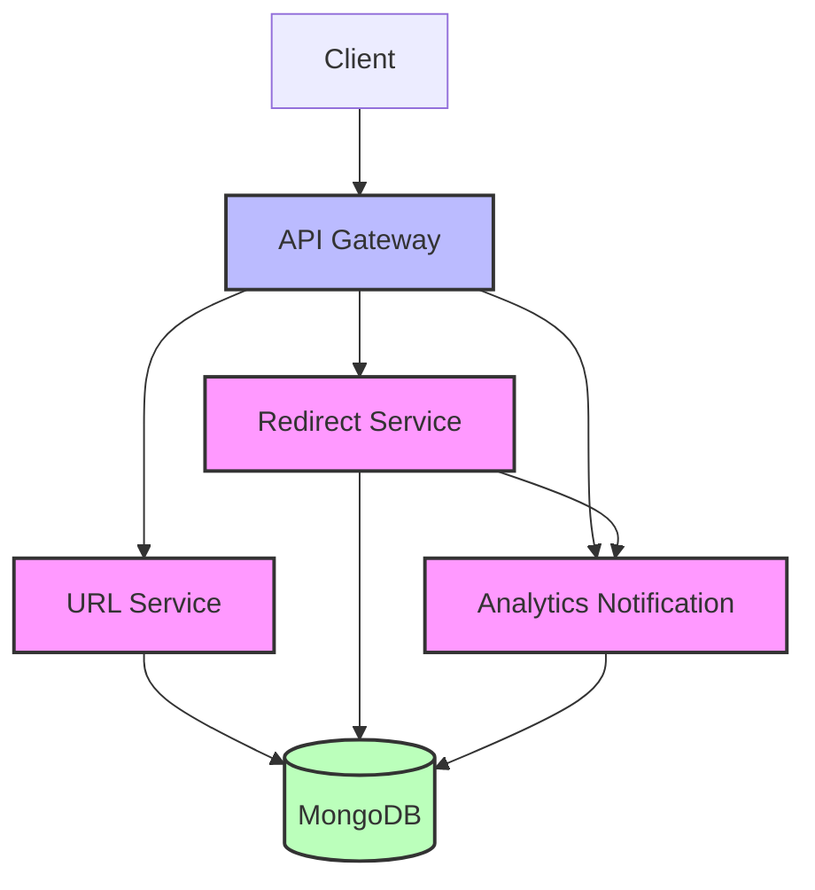

# URL Shortener Microservices Architecture

## Overview
This document describes the microservices architecture for the URL shortener application. The system is decomposed into four independent services:
1. API Gateway - Single entry point that routes requests to appropriate services
2. URL Service - Handles URL shortening logic
3. Redirect Service - Handles URL redirection and analytics notification
4. Analytics Service - Tracks access analytics for short URLs

All services share a MongoDB database for data persistence, with separate collections for URLs and analytics data.

## Architecture Diagram



## Service Responsibilities

### API Gateway
- **Port**: 8080
- **Routes**:
  - `POST /api/urls` → URL Service
  - `GET /api/analytics/:shortCode` → Analytics Service
  - `GET /:shortCode` → Redirect Service
- **Technology**: Node.js, Express, http-proxy-middleware

### URL Service
- **Port**: 3001
- **Endpoints**:
  - `POST /api/urls` - Create a shortened URL
  - `GET /health` - Health check
- **Responsibilities**:
  - Validate URL input
  - Generate unique Base62 short code
  - Store original URL + short code in database
  - Return shortened URL information
- **Technology**: Node.js, Express, MongoDB (Mongoose)

### Redirect Service
- **Port**: 3002
- **Endpoints**:
  - `GET /:shortCode` - Redirect to original URL
  - `GET /health` - Health check
- **Responsibilities**:
  - Look up original URL by short code
  - Perform HTTP 302 redirect
  - Notify Analytics Service asynchronously (fire-and-forget)
  - Handle 404 for non-existent short codes
- **Technology**: Node.js, Express, MongoDB (Mongoose), Axios (for analytics notification)

### Analytics Service
- **Port**: 3003
- **Endpoints**:
  - `POST /api/analytics/track` - Record an access (internal use)
  - `GET /api/analytics/:shortCode` - Get analytics for a short code
  - `GET /health` - Health check
- **Responsibilities**:
  - Record access events with timestamp
  - Provide analytics data (count, last accessed, access log)
  - Handle concurrent access correctly
- **Technology**: Node.js, Express, MongoDB (Mongoose)

## Data Model

### URL Collection
Stores the mapping between short codes and original URLs:
```javascript
{
  originalUrl: String (required),
  shortCode: String (unique, indexed),
  createdAt: Date (default: now)
}
```

### Analytics Collection
Stores access events for analytics:
```javascript
{
  shortCode: String (required, indexed),
  accessTimestamp: Date (default: now, indexed)
}
```

## Communication Patterns

### Synchronous HTTP
- Client → API Gateway → Services (REST over HTTP)
- Standard request/response pattern for user-facing operations

### Asynchronous Fire-and-Forget
- Redirect Service → Analytics Service (HTTP POST)
- Analytics failures do not impact redirect performance
- Short timeout (1 second) to prevent blocking

## Deployment

The application can be deployed using Docker Compose:
```bash
docker compose up --build
```

This will start:
- MongoDB database on port 27017
- URL Service on port 3001
- Redirect Service on port 3002
- Analytics Service on port 3003
- API Gateway on port 8080

## Environment Variables

Each service requires the following environment variables:
- `PORT`: Service port
- `MONGO_URI`: MongoDB connection string
- Service-specific URLs (for inter-service communication)

See individual service `.env.example` files for details.

## Scalability Notes

- Each service can be scaled independently based on demand
- The API Gateway provides load balancing and routing
- Database is the central point of coordination (acceptable for this assignment)
- In production, consider database-per-service pattern for loose coupling